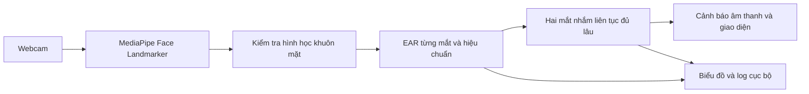

# Vin Driver Watch — kịch bản trình bày 10 phút

## Bài toán và phạm vi

Người dùng mục tiêu là tài xế VinBus / VinFast và người phụ trách an toàn đội xe. Một tín hiệu dễ quan sát trong demo là hai mắt nhắm kéo dài. Hệ thống dùng camera thông thường để nhận biết tín hiệu đó và nhắc nghỉ ngơi bằng âm thanh, không lưu video tài xế.

Prototype tập trung vào một vòng đầu vào → đo → quyết định → phản hồi có thể giải thích. Không suy luận danh tính, không điều khiển xe, không khẳng định rằng mọi lần nhắm mắt đều là buồn ngủ.

## Chuẩn bị trước khi lên trình bày

1. Chạy `npm install`, `npm run setup`, `npm test`, `npm start` trước giờ demo. Dùng Chrome/Edge tại `http://127.0.0.1:8080`.
2. Kiểm tra webcam, âm lượng loa, ánh sáng mặt và quyền camera trên đúng laptop sẽ trình bày.
3. Chạy thử trực tiếp và xuất JSON của phiên. Dữ liệu này mới là bằng chứng về model trên người, khác với mô phỏng logic.
4. Tự quay video màn hình dự phòng 30–60 giây gồm hiệu chuẩn, chớp mắt, nhắm mắt và mất khuôn mặt. Dùng công cụ quay màn hình của máy; ứng dụng không tự ghi hình.
5. Đọc file `EVALUATION.md`, điền kết quả thật, chọn một ca lỗi có thể lặp lại. Không trình bày con số chưa đo.

## Phút 0–1: vấn đề và người dùng

“Nhóm chọn bài toán nhắc nghỉ ngơi khi tài xế có dấu hiệu nhắm mắt kéo dài. Bối cảnh ứng dụng là VinBus hoặc VinFast. Trong phạm vi hai giờ, nhóm làm một demo đo được trên laptop, phản hồi ngay và giữ hình ảnh cục bộ.”

Nói rõ đây là đề xuất capstone; không phải sản phẩm chính thức hay hệ thống đã triển khai của Vin.

## Phút 1–5: demo trực tiếp

| Thao tác | Điều cần cho hội đồng thấy |
|---|---|
| Bật webcam, mở mắt nhìn thẳng 3 giây | Mốc mắt được tìm thấy, ngưỡng được hiệu chuẩn riêng |
| Chớp mắt bình thường vài lần | EAR giảm ngắn, số chớp tăng, không có cảnh báo |
| Nhắm cả hai mắt 2–3 giây | Bộ đếm tăng; sau 1.5 giây cảnh báo hình ảnh và âm thanh |
| Mở mắt | Cảnh báo kết thúc, biểu đồ và sự kiện vẫn còn |
| Che mặt hoặc rời khung | Hiện “Thiếu tín hiệu”; hệ thống không gọi trạng thái này là bình thường |
| Trở lại nhìn thẳng | Bộ đếm nhắm mắt được bắt đầu lại |
| Dừng và xuất dữ liệu | JSON có nguồn `camera`, cấu hình, số đo và sự kiện |

Cho hội đồng tự thử đầu vào: người khác ngồi vào, hiệu chuẩn lại, thử nhắm mắt. Khi hiệu chuẩn lại, các bộ đếm mắt bắt đầu lại; xuất phiên trước nếu cần giữ kết quả cũ.

Nếu webcam lỗi, chuyển sang video dự phòng và nói rõ đó là video. Nút mô phỏng dùng minh họa thuật toán; không dùng kết quả mô phỏng thay cho bằng chứng webcam.

## Phút 5–7: kiến thức, bằng chứng và tác động

Luồng kiến trúc:

Các trụ cột có thể giải thích bằng mã:

| Trụ cột | Áp dụng | Vị trí |
|---|---|---|
| Học | Model pretrained định vị khuôn mặt và mốc mắt; không train lại | `src/app.js`, `loadModel` |
| Biểu diễn | Sáu điểm của mỗi mắt → hai EAR → trạng thái theo thời gian | `src/monitor.js`, `EYES` |
| Hình học | EAR trong tọa độ pixel; sàng lọc góc mặt và kích thước | `eyeAspectRatio`, `measureFace` |
| Thời gian | Thời gian thực từ timestamp; không cộng dồn hai lần nhắm bị gián đoạn | `DrowsinessMonitor.update` |
| Bằng chứng | Độ trễ suy luận, thời gian nhắm, log sự kiện, ca lỗi | JSON xuất, `tests/monitor.test.js` |

Công thức với sáu điểm theo thứ tự vòng mắt:

`EAR = (distance(p2,p6) + distance(p3,p5)) / (2 × distance(p1,p4))`

`nhắm = max(EAR_trái, EAR_phải) < ngưỡng_hiệu_chuẩn`

Ngưỡng là 68% EAR mở ở phân vị 70%, giới hạn [0.10, 0.32]. Đây là heuristic cần đánh giá theo người và điều kiện sử dụng. Chỉ cảnh báo sau thời gian liên tục; không coi một ảnh mắt nhắm là bằng chứng buồn ngủ.

Trình bày một số đo thật theo `EVALUATION.md` và một ca sai. Bộ kiểm thử logic xác nhận cảnh báo ở đúng 1500 ms trên tín hiệu tổng hợp; độ trễ toàn hệ thống còn bao gồm chu kỳ lấy mẫu, suy luận, render và lỗi nhận diện.

Ước lượng impact để thảo luận, **chỉ là giả định minh họa**: nếu thử nghiệm trên 100 xe, mỗi xe 2 ca/ngày, trong 30 ngày sẽ quan sát được 6000 ca. Nếu mất 5 phút/ca để xem lại toàn bộ thủ công thì cần 500 giờ. Nếu chỉ xem các đoạn sự kiện và giảm được 80% thời gian xem lại thì tiết kiệm tối đa 400 giờ/tháng theo các giả định này. Bản hiện tại chưa thu video/triển khai quy trình xem lại; đây là giả thuyết để đo trong giai đoạn tiếp theo, không phải kết quả đã đạt.

Lộ trình: thu dữ liệu tình nguyện có đồng thuận → đánh giá theo người, kính và ánh sáng → đo báo nhầm/giờ → kiểm tra phần cứng cabin → nghiên cứu riêng tư và khả năng tích hợp. Chưa dùng số liệu này để suy ra giảm tai nạn.

## Phút 7–10: câu hỏi thường gặp

- **Vì sao không gọi model rồi kết luận ngay?** Mốc mắt mới là đầu vào. Đội bổ sung hình học, hiệu chuẩn, xử lý thời gian, kiểm soát thiếu dữ liệu và log để tạo quyết định giải thích được.
- **Vì sao chọn max của hai EAR?** Nháy một mắt không nên bị coi là cả hai mắt nhắm. Đổi lại, một mắt bị model dự đoán mở sai có thể gây bỏ sót; cần đo trade-off.
- **Che mắt có được cảnh báo không?** Không thể biết chắc. Nếu mất mốc hoặc hình học không hợp lệ thì thiếu tín hiệu. Model vẫn có thể dựng mốc sai hợp lý trên kính tối màu và bỏ sót; đây là ca lỗi quan trọng.
- **Dữ liệu đi đâu?** Khung hình xử lý tại trình duyệt. Không có API nhận video. Server chỉ phục vụ file; dữ liệu số được xuất khi người dùng yêu cầu.
- **Con số tỉ lệ nhắm mắt có chẩn đoán buồn ngủ không?** Không. Nó tính cả chớp mắt, dùng mẫu hợp lệ trong 60 giây gần nhất và luôn hiển thị thời gian quan sát thực tế.
- **Vì sao cần hiệu chuẩn?** Hình dạng mắt, góc nhìn và khoảng cách thay đổi theo người. Hiệu chuẩn giảm phụ thuộc một ngưỡng chung, nhưng không loại bỏ các sai số của model.
- **Ai làm phần nào?** Phân vai theo thực tế đội: camera/model; hình học/bộ đếm; giao diện/log; đánh giá/demo. Mọi thành viên cần hiểu toàn bộ luồng.
